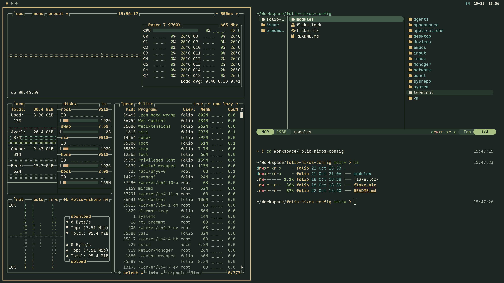

<div align="center">

# Folio · NixOS Configuration

A readable Niri desktop, shared themes, and configuration managed through YANG and sysrepo.

[The journey](#the-journey-to-folio) · [Desktop](#desktop) · [Architecture](#architecture) · [Themes](#themes) · [Limitations](#current-limitations)

</div>



<p align="center"><sub>Everforest Dark · Niri · Foot · Yazi · Btop · Maple Mono NF CN</sub></p>

Folio is my personal NixOS and standalone Home Manager configuration for
`x86_64-linux`. It brings machine policy, the desktop and managed applications
into one repository. This README explains the choices behind it, for people
looking for ideas to adapt to their own configurations.

## The journey to Folio

My first NixOS configuration put everything into a single Nix file. That was easy
to start with: every setting was in one place, and adding something meant finding
a spot for it. As the configuration grew, the file became increasingly bloated.
It became harder to see where one piece of configuration ended and another began.

I built [Koru](https://github.com/WallyHao/koru-nixos-dotfiles) to address that.
It was my first attempt at modularization, with a separate configuration file for
each application. That made the repository easier to navigate, but the same
problem returned inside the more complicated applications. One file per program
was still a large file once that program needed enough configuration.

In Sylphy, a configuration I have since deleted, I introduced stronger constraints
and gave each application a small project directory of its own. Configuration,
helpers and supporting files could be organized together. There were real
benefits, but adding a module became much more expensive. The structure required
so much work that I soon abandoned it.

Folio comes from reconsidering that trade-off. I still want clear boundaries,
validation and predictable behavior, but I also want to be able to add and change
modules without rebuilding the same management machinery each time. Here, YANG
and sysrepo provide a common configuration framework that connects most modules.
They give me shared rules for describing, validating and storing settings, while
modules retain ownership of their implementation.

That reduces the amount of infrastructure I have to write for each capability
and preserves many of the guarantees I wanted from Sylphy's stricter structure.
It also gives shared concerns, especially appearance, a place to be managed
across the system. There is still complexity to maintain; this is the balance I
am exploring in Folio.

The same reconsideration extends to tool selection and the control panel. I am
paying more attention to how the pieces work together in daily use. The CLI
provides a common management interface, while the panel makes routine desktop
controls accessible through a local graphical interface. Both use the same
backends, so improving usability can build on the existing configuration model.

## What defines Folio

| Choice | What it provides |
| --- | --- |
| Shared appearance | One global theme selection drives system, desktop, terminal and managed application colors. |
| Modeled configuration | YANG describes settings and constraints; sysrepo validates and persists desired state. |
| Capability-owned modules | Each capability keeps its schema, packages, commands, runtime and tests together. |
| Coordinated deployment | Reviewed source and configuration are captured together, then applied through NixOS and Home Manager. |
| Recorded recovery | Persistent workers, journals and retained revisions support inspection, resume and rollback. |
| Common controls | The CLI and local panel expose module backends through consistent interfaces. |
| A movable installation | One USB installation serves the supported laptop and desktop, with a separate disposable VM target for testing. |

## Desktop

The desktop uses Niri's scrolling layout, a dark green Everforest palette and
Maple Mono NF CN for mixed Chinese and Latin text. The current Everforest variant
has deeper backgrounds and brighter text for stronger contrast.

Visual details follow the shared palette: the focused window ring, cursor
outline and Yazi icons use the same accent, while file icons retain their
individual shapes. Waybar, notifications, the launcher and local panel also
receive the selected colors.

| Area | Components |
| --- | --- |
| Window management | Niri, with a patched focus-ring fade |
| Bar, launcher and notifications | Waybar, Fuzzel and Mako |
| Terminal and shell | Foot, Zsh and Powerlevel10k |
| Files and navigation | Yazi, eza, fd, fzf, ripgrep and zoxide |
| Monitoring | Btop |
| Notes and editing | Emacs, Org and Org-roam; configuration is still preliminary |
| Coding agents | Codex CLI and Pi |
| Browser | Zen Browser Beta |
| Documents and images | Zathura, imv and Typst |
| Input method | Fcitx5 and Rime Ice |
| Fonts and cursor | Maple Mono NF CN and a recolored GoogleDot cursor |
| Desktop controls | Folio's local browser panel |
| Optional tools | OBS Studio, Flatpak applications and Isaac Sim / Isaac Lab helpers |

Module and application selections determine which components are installed.
Personal profiles, credentials, notes and sessions remain owned by their
applications.

## Architecture

Folio organizes code by capability. A module can contribute to the system, the
user environment, or both, while keeping its schema and runtime behavior nearby.
The root has one Flake and one dependency lock.

```text
.
├── flake.nix                  # public outputs
├── flake.lock                 # shared dependency lock
├── assets/screenshots/        # desktop previews
├── docs/reference.md          # detailed technical and operational reference
└── modules/
    └── <capability>/
        ├── default.nix        # public exports and composition contract
        ├── model/             # YANG models and retained revisions
        ├── src/               # Nix packages and system/user configuration
        ├── cli/               # command adapters
        ├── runtime/           # subscribers, workers and operations
        └── tests/             # checks owned by the module
```

Directories are present where the capability needs them. Module selection is
explicit; keeping a module's source in the repository does not enable it.

### From configuration to a running system

YANG defines the shape of settings, including types, defaults and constraints.
Sysrepo stores the validated desired configuration. The manager captures that
configuration with its source and model identities into immutable inputs for Nix.
NixOS and Home Manager then build and activate the corresponding environments.
Nix evaluation consumes the captured data without querying live sysrepo state.

This separates saving a setting from applying it. A deployment can be reviewed
before activation, and the recorded inputs explain what was applied. System and
user activation are coordinated, while their repositories retain separate state
and permissions.

The shared framework handles configuration and deployment concerns across
modules. Each capability still owns the behavior specific to its services and
applications. The [module catalogue](docs/reference.md#module-catalogue) and
[public Nix contract](docs/reference.md#public-nix-contract) describe those
boundaries in detail.

## Themes

Shared appearance is one of the main reasons I introduced sysrepo. I want to
choose a theme once and carry it through the system, desktop and managed
applications, with coordinated switching from a single global selection.

| Scheme | Character | Modes |
| --- | --- | --- |
| Everforest | Green surfaces, warm text and yellow emphasis; adapted for stronger contrast | Dark and light |
| Folio Graphite | Neutral surfaces with blue emphasis | Dark and light |

The [palette catalogue](modules/appearance/lib) defines shared colors and
semantic roles such as background, foreground and accent. Components consume
those roles so the same visual purpose stays consistent across applications.
Resolved appearance metadata also lets the panel read the selected palette.

Theme selection belongs to the system and applies across both system and user
configuration. Switching coordinates the resulting deployment. Some running
applications still need reopening to load their new styles.

## Usability and management

The CLI brings module settings, deployment review, diagnostics and recovery into
one interface. Accepted deployment work runs in persistent workers, so its
lifetime does not depend on keeping a terminal open. History and journals make
partial results available for inspection after an interruption.

The local panel makes common tasks easier to reach: networking, proxy selection,
audio, display controls, device information, software management and settings.
It shares the CLI's backends and follows the desktop palette. This lets the
graphical interface use the same validation and operation records as the rest
of the system.

Application ownership is explicit. Native packages follow Nix generations;
managed Flatpak applications have their own recorded lifecycle. Personal data
remains separate from managed configuration. Retained deployment rollback covers
recorded artifacts and configuration, while application data and independently
managed Flatpak revisions require their own recovery paths.

I introduced Flatpak to make installing desktop applications easier. Applications
available through Flathub can be found and installed from the panel without
writing a Nix package declaration or rebuilding the system for each installation.
This complements the native packages managed by Nix and makes adding everyday
software more approachable. Folio records which applications it manages and
preserves personal data when removing them.

## Hardware and portability

The physical configuration runs from an existing USB installation shared between
my laptop and desktop. It uses Btrfs subvolumes for root, home and the Nix store,
with explicit root and EFI identities.

| Target | Purpose |
| --- | --- |
| `folio` | Existing USB installation shared between the supported machines |
| `portable` | Disposable x86_64 UEFI guest for development and acceptance |

The supported machines are a Lenovo Legion Y7000 IRX9 with an i7-13650HX and
RTX 4060, and an MSI MAG B650M MORTAR WIFI desktop with a Ryzen 7 9700X and
RTX 3090. The graphics configuration includes Intel, AMD and NVIDIA support
without fixed DRM card numbering in Niri.

Hardware policy lives in the [system target](modules/system/src/folio.nix) and
[device target](modules/devices/src/folio.nix), composed through
[targets.nix](modules/manager/src/targets.nix). This is a personal installation;
its storage identities and account policy need adapting for other hardware.

## Current limitations

**Development toolchains are still an open problem.** This version does not yet
have a settled approach to organizing and maintaining them. The presence of
terminal utilities and optional simulation helpers does not make the repository
a complete development environment.

**The text editor configuration is still preliminary.** Emacs, Org and Org-roam
are present, but the editor has not received the detailed configuration needed
to make it a finished part of the overall workflow.

The shared management framework also has a cost: models, migrations and runtime
integration need maintenance. Folio reduces repeated work across modules, but
adding a capability still requires deciding what belongs in that common model.

Checks cover configuration, deployment coordination, the panel, applications and
disposable UEFI guests. Successful builds and guest checks do not establish
hardware behavior on every machine. The
[verification reference](docs/reference.md#verification-map) records the scope
and limits of that evidence.

## Model upgrades

Changes to YANG models or repository tools require paired maintenance of the
configuration repository and its matching closure for each affected scope.
The [model upgrade reference](docs/reference.md#model-upgrades) retains the
technical procedure and recovery details.

## References

- [Koru](https://github.com/WallyHao/koru-nixos-dotfiles) — my earlier configuration and the presentation reference for this README.
- [Sysrepo](https://github.com/sysrepo/sysrepo) — the configuration datastore used to connect Folio's modules.
- [YANG 1.1 — RFC 7950](https://www.rfc-editor.org/rfc/rfc7950.html) and [YANG JSON encoding — RFC 7951](https://www.rfc-editor.org/rfc/rfc7951.html) — the configuration modeling and encoding standards.
- [Flatpak](https://flatpak.org/) — desktop application distribution alongside native Nix packages.

The repository's [technical reference](docs/reference.md) preserves detailed
architecture, operation and recovery notes.
